  

  
  
  

  
  
  
  
  

  

## The Site

A personal data portfolio: interactive dashboards, data models and ETL pipelines built with Power BI, SQL, Excel and Python, presented as one polished single-page experience.

| | |
|---|---|
| 🗂️ **Work on display** | Projects, case studies and certificates in folders that open on hover |
| 🌐 **Two languages** | Full English and Arabic versions, with dark and light mode |
| 🧊 **3D data visuals** | Animated visuals that scale down gracefully on weaker devices |
| ✉️ **Contact built in** | LinkedIn and email one click away |
| 🛠️ **Admin panel** | Site content editable from a built-in admin panel |

## Under the Hood

A single self-contained `index.html` — HTML, CSS and JavaScript, no build step — hosted on GitHub Pages.

  

## License

Copyright (c) 2026 Mohammad Khairy. All rights reserved. See [LICENSE](LICENSE). The code, design and media may not be copied or reused without written permission.
